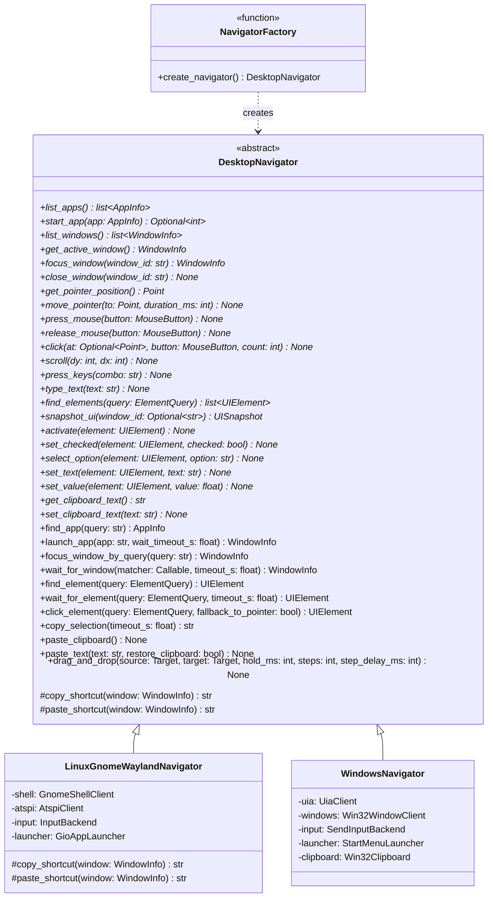
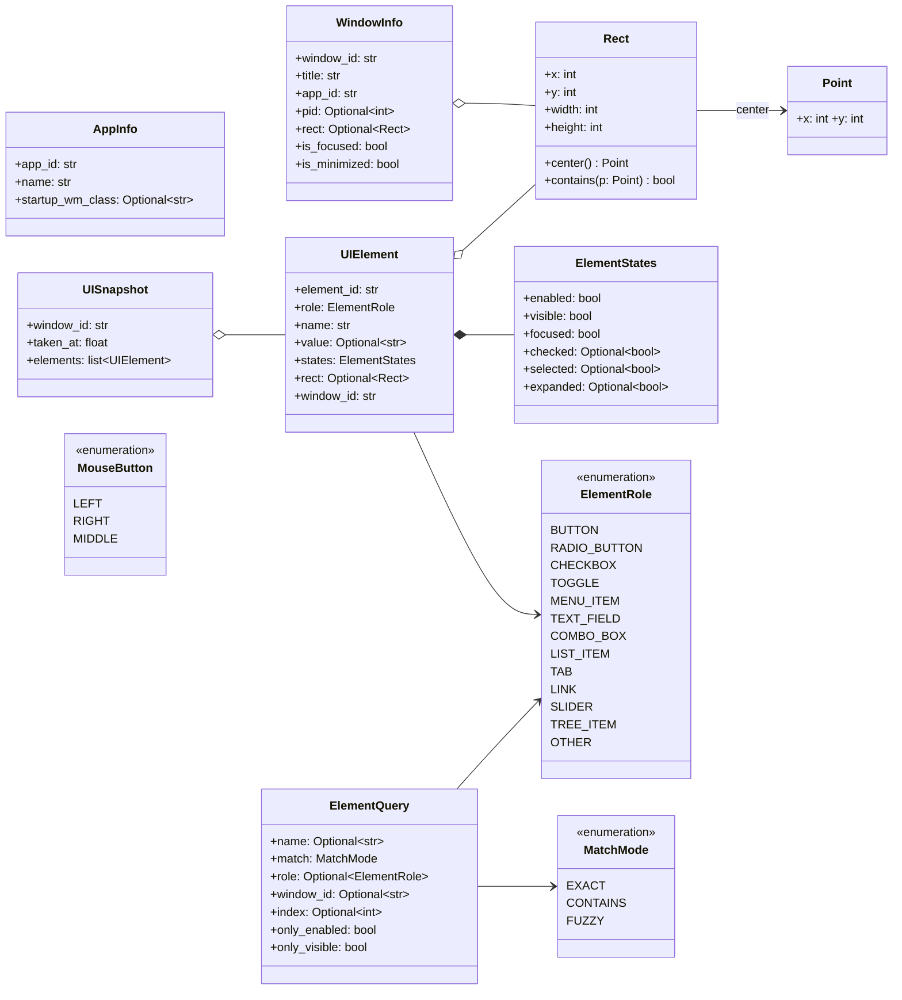
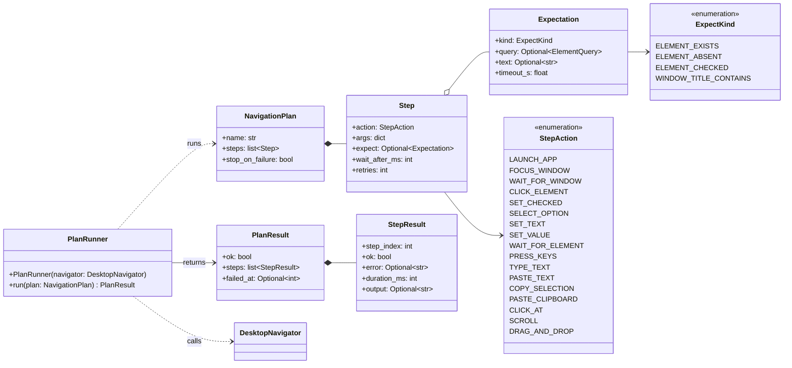
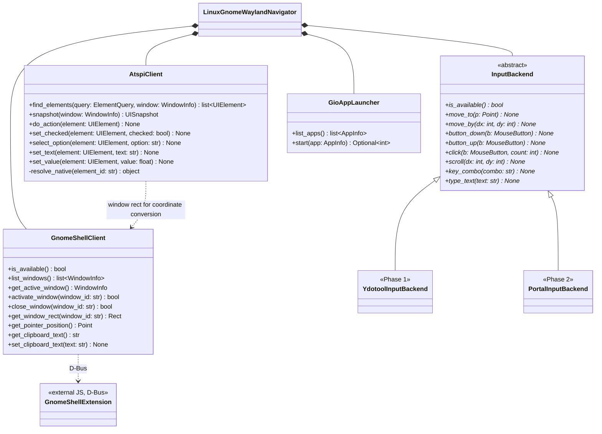
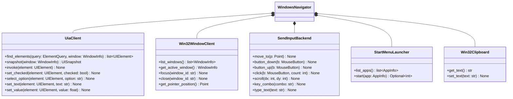
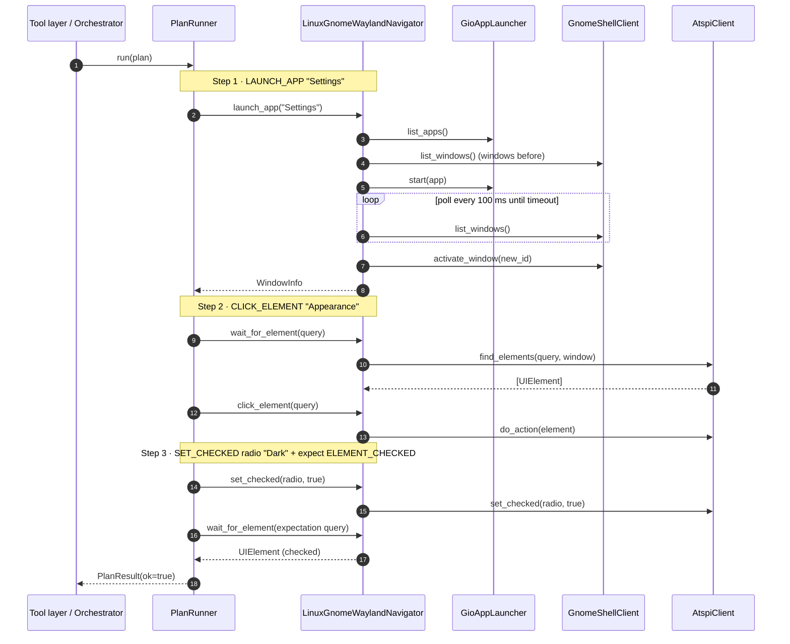
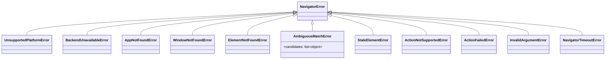

# Desktop Navigator: OOP design (GNOME Wayland + Windows)

## 1. Design decisions

1. **One abstract class, `DesktopNavigator`.** Platform differences live in *abstract primitives*, which each platform implements. Shared behavior (launch flow, copy/paste, drag and drop, waiting, matching) is written once in the base class from those primitives (Template Method pattern).
2. **Semantic first, pixels last.** UI elements are driven through the accessibility API (AT-SPI on Linux, UI Automation on Windows). Raw mouse coordinates are the fallback and are never used silently.
3. **Multi-step operations are data, not code.** A `NavigationPlan` is a list of `Step` objects run by a separate `PlanRunner`. A tool-calling model or a planner can emit plans as JSON.
4. **The API is synchronous and not thread-safe.** The orchestrator calls it from one worker thread or process.
5. **Coordinates** are global logical pixels in the compositor's coordinate space, with the origin at the top-left. On Windows, the process must be DPI-aware.

## 2. File layout (extends your tree)

```
navigator/
├── browser/                      # untouched
└── desktop/
    ├── __init__.py               # exports: create_navigator, DesktopNavigator, models, errors
    ├── models.py                 # dataclasses + enums (Section 4)
    ├── errors.py                 # exception hierarchy (Section 8)
    ├── base.py                   # DesktopNavigator (ABC) + shared logic
    ├── plan.py                   # Step, NavigationPlan, PlanRunner, PlanResult
    ├── factory.py                # create_navigator()
    ├── main.py                   # existing file: manual smoke-test script
    ├── linux/
    │   ├── __init__.py
    │   ├── navigator.py          # LinuxGnomeWaylandNavigator
    │   ├── shell_client.py       # GnomeShellClient   (D-Bus → extension)
    │   ├── atspi_client.py       # AtspiClient        (accessibility tree)
    │   ├── input_backends.py     # InputBackend, YdotoolInputBackend, PortalInputBackend
    │   ├── keymap.py             # key-name → Linux keycode table
    │   ├── app_launcher.py       # GioAppLauncher
    │   └── extension/navigator-shell@local/{metadata.json, extension.js}
    └── windows/
        ├── __init__.py
        ├── navigator.py          # WindowsNavigator
        ├── uia_client.py         # UiaClient
        ├── window_client.py      # Win32WindowClient
        ├── input_backend.py      # SendInputBackend
        ├── app_launcher.py       # StartMenuLauncher
        └── clipboard.py          # Win32Clipboard
tests/desktop/                    # FakeNavigator unit tests + @pytest.mark.gnome integration tests
```

## 3. Class diagram: navigator hierarchy

`*` marks an **abstract** method (each platform implements it). Methods without `*` are **concrete** and implemented once in `base.py`. Defaults are in the contract tables (Section 7).



## 4. Class diagram: models

`Target` is a type alias: `Target = Point | UIElement`. All models are `@dataclass(frozen=True, slots=True)`.



## 5. Class diagram: multi-step plans



## 6. Class diagrams: platform internals

### Linux (GNOME on Wayland)



### Windows



## 7. Sequence diagram: multi-step plan

Example plan: *"Open Settings, go to Appearance, choose Dark."*



## 8. Method contracts

### 8.1 Abstract methods (platform primitives)

| Method | Defaults | Contract | Raises |
|---|---|---|---|
| `list_apps()` | none | Visible launchable apps only. Linux: `.desktop` entries with `NoDisplay=false`. Windows: Start Menu shortcuts + UWP apps. | `BackendUnavailableError` |
| `start_app(app)` | none | Starts the app without waiting for a window. Returns the PID if known, else `None`. | `ActionFailedError` |
| `list_windows()` | none | All normal top-level windows. **Order: most recently focused first.** | `BackendUnavailableError` |
| `get_active_window()` | none | The focused window. | `WindowNotFoundError` if none |
| `focus_window(window_id)` | none | Raises the window, un-minimizes it, gives it keyboard focus. Returns refreshed `WindowInfo`. | `WindowNotFoundError`, `ActionFailedError` |
| `close_window(window_id)` | none | Requests a graceful close. Never force-kills. Apps may show a "save?" dialog, and that is not an error. | `WindowNotFoundError` |
| `get_pointer_position()` | none | Current pointer position in global coordinates. | `BackendUnavailableError` |
| `move_pointer(to, duration_ms)` | `duration_ms=0` | Absolute move. If `duration_ms>0`, interpolates in steps of ≤10 ms. | `BackendUnavailableError` |
| `press_mouse(button)` / `release_mouse(button)` | none | Raw button down/up. Used by drag and drop. | `BackendUnavailableError` |
| `click(at, button, count)` | `at=None`, `button=LEFT`, `count=1` | If `at` is given, moves there first. `at=None` clicks at the current position. `count=2` is a double-click. | `BackendUnavailableError` |
| `scroll(dy, dx)` | `dx=0` | Wheel notches. **Positive `dy` scrolls down, positive `dx` scrolls right.** Scrolls under the current pointer. | `BackendUnavailableError` |
| `press_keys(combo)` | none | Combo string, lowercase, `+`-joined, for example `"ctrl+shift+t"`. See 8.4. | `InvalidArgumentError` for unknown key |
| `type_text(text)` | none | Types literal characters. **Linux (ydotool) is US-layout ASCII only.** Non-ASCII or long text must use `paste_text`. | `InvalidArgumentError` if unsupported chars |
| `find_elements(query)` | none | Matching elements in document order (FUZZY: by score descending). Applies `only_enabled` and `only_visible`. If `query.window_id` is `None`, searches the **active window only**. Returns `[]` when nothing matches. | `WindowNotFoundError` |
| `snapshot_ui(window_id)` | `None` = active window | All actionable or text-bearing elements, flattened. For debugging and "what's on screen". | `WindowNotFoundError` |
| `activate(element)` | none | Default action: press, invoke, follow link, open menu item. No pointer fallback here. | `StaleElementError`, `ActionNotSupportedError`, `ActionFailedError` |
| `set_checked(element, checked)` | none | CHECKBOX and TOGGLE: no-op if already in the requested state, else toggles. RADIO_BUTTON: only `True` is allowed (`False` raises `ActionNotSupportedError`). After acting, re-reads state and raises `ActionFailedError` on mismatch. | as `activate` |
| `select_option(element, option)` | none | For COMBO_BOX or list containers. Opens if needed, matches the option name (EXACT first, then CONTAINS), selects it. | `ElementNotFoundError` if option is missing |
| `set_text(element, text)` | none | Replaces the full contents of a TEXT_FIELD. | `ActionNotSupportedError` if read-only |
| `set_value(element, value)` | none | Sets a SLIDER or spin value within its min/max. | `InvalidArgumentError` if out of range |
| `get_clipboard_text()` | none | Returns the clipboard's plain text, or `""` if it holds non-text. | `BackendUnavailableError` |
| `set_clipboard_text(text)` | none | Replaces the clipboard with plain text. | `BackendUnavailableError` |

### 8.2 Concrete methods (implemented once in `base.py`)

| Method | Defaults | Exact behavior |
|---|---|---|
| `find_app(query)` | none | Resolve against `list_apps()`: (1) exact `app_id`, (2) exact name (case-insensitive), (3) FUZZY name with rapidfuzz `WRatio ≥ 85`. If two different apps tie within 5 points → `AmbiguousMatchError`. None → `AppNotFoundError`. |
| `launch_app(app, wait_timeout_s)` | `wait_timeout_s=5.0` | 1. `info = find_app(app)`. 2. `before = {window ids}`. 3. `start_app(info)`. 4. Wait for a window **not in `before`** whose `app_id` equals `info.app_id` or `info.startup_wm_class` (case-insensitive). 5. On timeout: if the app already has a window, focus the most recent one and return it, else raise `NavigatorTimeoutError`. 6. Focus and return the window. |
| `focus_window_by_query(query)` | none | FUZZY match (`WRatio ≥ 80`) over `title` and `app_id` of `list_windows()`. Ties within 5 points between different windows → `AmbiguousMatchError`. None → `WindowNotFoundError`. Then `focus_window`. |
| `wait_for_window(matcher, timeout_s)` | `timeout_s=5.0` | Poll `list_windows()` every 0.1 s. Return the first window where `matcher(w)` is true. |
| `find_element(query)` | none | Calls `find_elements`. 0 results → `ElementNotFoundError`. 1 → return it. More than 1: if `query.index` is set, return `results[index]`; if `None`, raise `AmbiguousMatchError(candidates)`. |
| `wait_for_element(query, timeout_s)` | `timeout_s=5.0` | Poll `find_element` every 0.1 s, ignoring only `ElementNotFoundError`. `AmbiguousMatchError` propagates immediately. |
| `click_element(query, fallback_to_pointer)` | `fallback_to_pointer=False` | `find_element` → `activate`. On `ActionNotSupportedError`, if `fallback_to_pointer` and `element.rect` exists → `click(at=rect.center())`, else re-raise. |
| `copy_selection(timeout_s)` | `timeout_s=1.0` | 1. `set_clipboard_text(<unique sentinel>)`. 2. `press_keys(copy_shortcut(active_window))`. 3. Poll `get_clipboard_text()` every 50 ms until it differs from the sentinel. 4. Return it. Timeout → `NavigatorTimeoutError("nothing selected")`. |
| `paste_clipboard()` | none | `press_keys(paste_shortcut(active_window))`. |
| `paste_text(text, restore_clipboard)` | `restore_clipboard=True` | Save the old clipboard, `set_clipboard_text(text)`, paste, sleep 150 ms, then restore the old clipboard. **This is the preferred way to insert long or non-ASCII text (including Malayalam).** |
| `drag_and_drop(source, target, hold_ms, steps, step_delay_ms)` | `hold_ms=150`, `steps=20`, `step_delay_ms=10` | Resolve each `Target` to a `Point` (`UIElement` → `rect.center()`; `rect is None` → `ActionNotSupportedError`). Then: `move_pointer(src)` → `press_mouse(LEFT)` → sleep `hold_ms` → loop `i=1..steps`: `move_pointer(lerp(src,dst,i/steps))`, sleep `step_delay_ms` → sleep 100 ms → `release_mouse(LEFT)`. **The release is in a `finally` block**, so the button is never left stuck. |
| `copy_shortcut(window)` / `paste_shortcut(window)` | none | Base returns `"ctrl+c"` / `"ctrl+v"`. Linux overrides to `"ctrl+shift+c"` / `"ctrl+shift+v"` when `window.app_id` is a known terminal (`org.gnome.Terminal`, `org.gnome.Ptyxis`, `org.gnome.Console`, `kitty`, `Alacritty`). |

### 8.3 Shared constants (top of `base.py`)
`POLL_INTERVAL_S = 0.1`, `DEFAULT_TIMEOUT_S = 5.0`, `FUZZY_APP_THRESHOLD = 85`, `FUZZY_WINDOW_THRESHOLD = 80`, `AMBIGUITY_MARGIN = 5`.

### 8.4 Key combo grammar
Tokens joined by `+`, all lowercase. Modifiers: `ctrl`, `alt`, `shift`, `super`. Named keys: `enter tab esc space backspace delete up down left right home end pageup pagedown f1..f12`. Single characters `a–z`, `0–9`, and common punctuation are allowed. Anything else raises `InvalidArgumentError`.

### 8.5 Match semantics (`ElementQuery`)
- `EXACT`: case-insensitive equality after stripping whitespace.
- `CONTAINS`: case-insensitive substring.
- `FUZZY`: rapidfuzz `WRatio ≥ 85`, sorted by score descending.
- `name=None` matches any name (use together with `role`).
- `index` is zero-based and applies to the ordered result list.

## 9. Plan step schema

`PlanRunner` dispatches each `StepAction` to a navigator method with these `args`. The runner validates args before executing, and every step re-finds elements from its query, so stale IDs never occur between steps.

| StepAction | Required args | Optional args | Calls |
|---|---|---|---|
| `LAUNCH_APP` | `app: str` | `timeout_s` | `launch_app` |
| `FOCUS_WINDOW` | `query: str` | none | `focus_window_by_query` |
| `WAIT_FOR_WINDOW` | `title_contains: str` | `timeout_s` | `wait_for_window` |
| `CLICK_ELEMENT` | `query: ElementQuery` | `fallback_to_pointer` | `click_element` |
| `SET_CHECKED` | `query`, `checked: bool` | none | `find_element` → `set_checked` |
| `SELECT_OPTION` | `query`, `option: str` | none | `find_element` → `select_option` |
| `SET_TEXT` | `query`, `text: str` | none | `find_element` → `set_text` |
| `SET_VALUE` | `query`, `value: float` | none | `find_element` → `set_value` |
| `WAIT_FOR_ELEMENT` | `query` | `timeout_s` | `wait_for_element` |
| `PRESS_KEYS` | `combo: str` | none | `press_keys` |
| `TYPE_TEXT` | `text: str` | none | `type_text` |
| `PASTE_TEXT` | `text: str` | none | `paste_text` |
| `COPY_SELECTION` | none | none | `copy_selection` (text → `StepResult.output`) |
| `PASTE_CLIPBOARD` | none | none | `paste_clipboard` |
| `CLICK_AT` | `x: int`, `y: int` | `button`, `count` | `click` |
| `SCROLL` | `dy: int` | `dx` | `scroll` |
| `DRAG_AND_DROP` | `source`, `target` (each `ElementQuery` or `{x,y}`) | `hold_ms`, `steps` | `drag_and_drop` |

**Runner rules:**
1. Run steps in order. After each: sleep `wait_after_ms`, then check `expect` (poll until `expect.timeout_s`).
2. On a step failure, retry up to `retries` times (sleep 0.3 s between attempts).
3. If still failing: record the `StepResult`, and if `stop_on_failure=True` stop and set `failed_at`.
4. `AmbiguousMatchError` is **never retried**. It is returned in `StepResult.error` with candidates so the caller can ask the user.

## 10. Platform mapping

| Primitive | Linux (GNOME Wayland) | Windows |
|---|---|---|
| `list_apps` / `start_app` | `Gio.DesktopAppInfo.get_all()`, `.launch()` | Start Menu `.lnk` files + `Get-StartApps` (UWP); launch via `os.startfile` or `explorer.exe shell:AppsFolder\<AppID>` |
| `list_windows`, `focus`, `close` | **Our GNOME Shell extension** over D-Bus (Section 11). `wmctrl` and `xdotool` do not work on Wayland. | `EnumWindows`, `SetForegroundWindow` (with the Alt-key-tap workaround for the foreground lock), `WM_CLOSE` |
| Pointer position | Extension `GetPointerPosition` | `GetCursorPos` |
| Mouse, keyboard | `InputBackend`: **Phase 1 `ydotool`** (needs `ydotoold` + `/dev/uinput` access). Phase 2: xdg-desktop-portal RemoteDesktop (libei). | `SendInput` (ctypes); set per-monitor DPI awareness at startup |
| Find and act on elements | AT-SPI via `gi.repository.Atspi`: `Action.do_action`, `Selection`, `EditableText.set_text_contents`, `Value.set_current_value` | UI Automation via `pywinauto` (`backend="uia"`): `InvokePattern`, `TogglePattern`, `SelectionItemPattern`, `ValuePattern`, `RangeValuePattern`, `ExpandCollapsePattern` |
| Clipboard | Extension `GetClipboardText` / `SetClipboardText` (`St.Clipboard`) | `win32clipboard` |

**Role mapping**

| `ElementRole` | AT-SPI role | UIA ControlType |
|---|---|---|
| BUTTON | `PUSH_BUTTON` | Button |
| RADIO_BUTTON | `RADIO_BUTTON` | RadioButton |
| CHECKBOX | `CHECK_BOX` | CheckBox |
| TOGGLE | `TOGGLE_BUTTON`, `SWITCH` | Button with TogglePattern |
| MENU_ITEM | `MENU_ITEM` | MenuItem |
| TEXT_FIELD | `TEXT`, `ENTRY`, `PASSWORD_TEXT` | Edit |
| COMBO_BOX | `COMBO_BOX` | ComboBox |
| LIST_ITEM | `LIST_ITEM` | ListItem |
| TAB | `PAGE_TAB` | TabItem |
| LINK | `LINK` | Hyperlink |
| SLIDER | `SLIDER`, `SPIN_BUTTON` | Slider, Spinner |
| TREE_ITEM | `TREE_ITEM` | TreeItem |
| OTHER | anything else | anything else |

## 11. Linux specifics (the parts most likely to bite)

**GNOME Shell extension** (GNOME 45+ ES-module format; I'm assuming Ubuntu 24.04 or similar, so adjust `metadata.json` `shell-version` to match yours).
- Bus name, object path, and interface: `org.navigator.Shell`, `/org/navigator/Shell`, `org.navigator.Shell` (session bus).

| D-Bus method | Returns | Notes |
|---|---|---|
| `ListWindows()` | `s` (JSON array: `id, title, app_id, pid, x, y, w, h, focused, minimized`) | MRU order, from the Shell's window tab list. `id` = Meta window id as a string. |
| `ActivateWindow(s id)` | `b` | Un-minimize + focus |
| `CloseWindow(s id)` | `b` | Graceful `delete` request |
| `GetPointerPosition()` | `(ii)` | |
| `GetClipboardText()` | `s` | `St.Clipboard` is async, so reply from its callback |
| `SetClipboardText(s)` | `b` | |

- **Loading:** symlink the extension folder into `~/.local/share/gnome-shell/extensions/`, run `gnome-extensions enable navigator-shell@local`. **On Wayland, a newly installed extension requires logging out and in once.**
- **Accessibility must be on:** `gsettings set org.gnome.desktop.interface toolkit-accessibility true`.

**Coordinate conversion (important).** On Wayland, native clients generally can't report global screen coordinates, so AT-SPI `Component.get_extents` with `CoordType.SCREEN` is unreliable. `AtspiClient` must request `CoordType.WINDOW` extents and add the window's `rect.x/y` from `GnomeShellClient.get_window_rect()`. The resulting `UIElement.rect` must be in global coordinates, or `None` if it can't be computed. Verify this per app early.

**Absolute pointer motion is the riskiest primitive.** Add an integration test that moves the pointer to 5 known points, reads each back with `get_pointer_position()`, and asserts ±2 px. If `ydotool` absolute moves are off because of pointer acceleration, calibrate or switch to the Phase 2 portal backend.

**Dependencies.** PyGObject comes from apt, so the project venv needs `--system-site-packages`:
```
sudo apt install python3-gi gir1.2-atspi-2.0 ydotool
python3 -m venv --system-site-packages .venv
pip install rapidfuzz
```
`ydotoold` must be running as your user, with `/dev/uinput` access (udev rule or `input` group). Chromium and Electron apps expose a thin accessibility tree unless started with accessibility enabled, so prefer your `navigator/browser` module for web content.

## 12. Errors (`errors.py`)



## 13. Coding rules for the implementing agent

1. Python 3.11+, full type hints, `from __future__ import annotations`, stdlib `dataclasses` only for models, no Pydantic in this package.
2. **No platform imports at module top level outside `linux/` and `windows/`.** `import gi` or `import pywinauto` happens only inside those packages, so the base package imports on any OS.
3. `create_navigator()` in `factory.py`: Linux requires `XDG_SESSION_TYPE == "wayland"` and `"GNOME"` in `XDG_CURRENT_DESKTOP`, Windows requires `sys.platform == "win32"`. Anything else raises `UnsupportedPlatformError` with a clear message.
4. Backends translate native exceptions into `NavigatorError` subclasses. **No raw `GLib.Error`, `subprocess` errors, or `COMError` may leak.**
5. Every public method logs at DEBUG via `logging.getLogger("navigator.desktop")`: name, key args, duration.
6. `element_id` is opaque and valid only until the next UI change. The backend keeps a handle cache; a lookup miss raises `StaleElementError`.
7. Never sleep blindly except where this document specifies a delay. Prefer polling with a timeout.
8. Never auto-fallback from semantic actions to pointer clicks. Only `click_element(..., fallback_to_pointer=True)` does that.
9. Destructive or irreversible decisions (confirm before sending, saving over files) belong to the orchestrator's policy layer, not here.

## 14. Implementation order and acceptance checks

| # | Build | Done when |
|---|---|---|
| 1 | `models.py`, `errors.py` | Unit tests: `Rect.center`, `ElementQuery` defaults, models are immutable |
| 2 | `base.py` + `FakeNavigator` in tests | Fake-backed tests pass for `launch_app`, `find_element` ambiguity, `copy_selection` timeout, `drag_and_drop` always releasing the button |
| 3 | `plan.py` | `PlanRunner` tests with the fake: retries, expectations, stop-on-failure, ambiguity not retried |
| 4 | GNOME extension + `GnomeShellClient` | `list_windows`, `focus_window`, clipboard round-trip work on your machine |
| 5 | `GioAppLauncher` | `launch_app("text editor")` returns a focused `WindowInfo` |
| 6 | `YdotoolInputBackend` + `keymap.py` | `press_keys("ctrl+a")`, `type_text("hello")`, and the pointer ±2 px test pass |
| 7 | `AtspiClient` | In GNOME Settings: find a button, toggle a switch, select a radio, set text in a search field |
| 8 | `LinuxGnomeWaylandNavigator` + `factory.py` + `main.py` | Smoke script: open Text Editor → `paste_text` a Malayalam sentence → select all → `copy_selection` → matches input |
| 9 | Plan demo | The Settings → Appearance → Dark plan in Section 7 passes end to end |
| 10 | Windows package | Same smoke script and the Notepad equivalent pass on Windows |

## 15. Known risks

1. **Absolute pointer positioning on Wayland** (Section 11). Everything else works without the mouse when AT-SPI exposes the element, so only drag and drop and the pointer fallback depend on it.
2. **Apps with poor accessibility trees** (some Electron and Qt apps, custom-drawn UIs). This is why `fallback_to_pointer` and `snapshot_ui` exist, and why you should test your target apps early.
3. **Extension loading UX**: a one-time logout/login after install. Document it in the README.

I can put this into a `DESIGN.md` for your repo, or start on step 1 and 2 (`models.py`, `errors.py`, `base.py`, and the `FakeNavigator` tests) so the agent has a working core to build on. Which would you prefer?